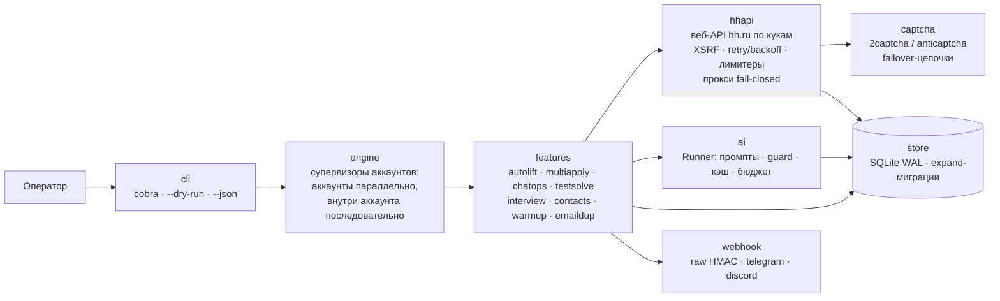

# hhauto

[](https://go.dev/dl/)
[](LICENSE)
[](#установка)

> Полностью автоматизированная воронка поиска работы на hh.ru: отклики → чаты → тесты → собес.

**hhauto** — один бинарник на Go. Настраиваете аккаунты, куки, прокси и профиль —
`hhauto run` ведёт воронку до приглашения на собеседование. Человек вмешивается
только в трёх точках: планирование собеса, флаговый вопрос (факта нет в резюме —
ИИ не выдумывает), реакция на техпаузу (капча исчерпана, разлогин).

---

## Содержание

- [⚠️ Дисклеймер](#️-дисклеймер)
- [Что это](#что-это)
- [Возможности](#возможности)
- [Архитектура](#архитектура)
- [Установка](#установка)
- [Быстрый старт](#быстрый-старт)
- [Конфигурация](#конфигурация)
- [Команды](#команды)
- [ИИ-провайдеры](#ии-провайдеры)
- [Безопасность](#безопасность)
- [Антибан-позиция](#антибан-позиция)
- [Ограничения](#ограничения)
- [Документация](#документация)
- [Лицензия](#лицензия)

## ⚠️ Дисклеймер

- **Проект не аффилирован с hh.ru.** Это неофициальный инструмент третьей стороны.
- **Автоматизация нарушает условия сервиса hh.ru.** Парсинг прямо запрещён
  (п. 4.2.13 правил), «массовые отклики» — основание для блокировки (п. 1.20
  оферты). **Риск блокировки аккаунта полностью на пользователе.**
- Используйте на свой риск. Рекомендуется отдельный тестовый аккаунт и режим
  полуавтомата: включайте фичи постепенно, начинайте с `--dry-run`, держите
  квоты ниже потолка, читайте вебхуки и очередь ревью.
- Куки аккаунта — это полный доступ к нему. Храните конфиг и data_dir как пароль.

## Что это

Публичный API hh.ru закрыт для соискателей с 15.12.2025, поэтому hhauto работает
через **веб-API сайта по кукам**: тот же браузерный поверх, что открывается в
веб-интерфейсе. Система ежедневно:

1. поднимает резюме и сканирует источники вакансий;
2. прогоняет кандидатов через каскад фильтров и ИИ-скоринг;
3. откликается с ИИ-сопроводительными письмами в рамках дневной квоты;
4. читает входящие чаты, решает тесты, отвечает из фактов пользователя;
5. собирает контакты, шлёт email-дубли, рапортует в вебхуки.

Всё состояние — в локальном SQLite. Всё исходящее проходит через идемпотентные
интенты и журнал решений ИИ — можно воспроизвести, почему был сделан отклик.

## Возможности

- **Автоподнятие резюме** — 6 раз/день (штатный 4-часовой таймер hh + джиттер),
  подтверждение чтением `updated_at`, капча решается через сервис.
- **Мультиотклик до 200/день на аккаунт** (официальный потолок hh) с каскадом:
  нативные фильтры (полное покрытие: роли, метро, форматы, метки, сортировка —
  плюс язык поисковых запросов в тексте) → exclude-слова (название + описание) →
  ЧС/БС компаний → рейтинг работодателя → дедуп → ИИ-скоринг с порогом →
  дневная квота → предфильтр осуществимости → отклик с ИИ-сопроводительным.
- **Автообщение (chatops)** — поллинг чатов, ИИ-классификация
  (отказ/приглашение/тест/вопрос/оффер/спам), автоответы **только из фактов**
  резюме и profile.md; собес и оффер останавливают чат и уведомляют.
- **Тесты** — внутренние тесты hh решаются ИИ батчами; внешние формы —
  по умолчанию только черновик (`draft_only`), headless-сабмит — opt-in.
- **Внешние формы** — детект ссылок по таблице хостов, анти-фишинг
  (белый список, аборт при поле пароля), изолированный контекст без hh-кук.
- **Контакты работодателей** — из карточки, сообщений и email, нормализация,
  дедуп, экспорт в CSV/JSON.
- **Автолив*** — выход из отклонённых чатов (выключен по умолчанию).
- **Автоподогрев*** — лестница пингов 24/48/96 ч при тишине
  (выключен по умолчанию).
- **Email-дубли откликов** — письмо с PDF резюме через SMTP (STARTTLS обязателен).
- **Вебхуки** — raw JSON с HMAC, retry и прокси на эндпоинт либо пресеты
  Telegram/Discord; фильтр по событиям.
- **Мультиаккаунт + прокси** — аккаунты без ограничений, изоляция cookie jar
  и User-Agent, прокси опционален и может разделяться между аккаунтами.
- **Капча-сервисы** — только платные API: 2captcha- и Anti-Captcha-совместимые
  протоколы (включая CapMonster Cloud), failover-цепочки, провайдеры шарятся.
- **Очередь ревью** — все флаги (недостающий факт, подозрение на инъекцию,
  неоднозначность) в одном человеко-контуре с SLA; `status`/`funnel` — воронка
  и счётчики; `backup` — 7 ротируемых копий БД.

`*` — фичи по умолчанию выключены, включаются в конфиге.

## Архитектура

Модульный монолит, один бинарник. Зависимости направлены вниз:
`cli → engine → features → {hhapi, ai, store}`; вся сеть — в `hhapi`, `ai`,
`proxy`, `webhook`; время и случайность инъецируются; состояние только в store.



## Установка

**Требования:** Go **1.26+** (только для сборки), аккаунт hh.ru, куки сессии.

### Готовые бинарники

Релизы собираются [goreleaser](https://goreleaser.com) — 6 целей:
`linux/darwin/windows × amd64/arm64`, CGO отключён. Скачайте архив со страницы
Releases репозитория и распакуйте бинарник в `PATH`.

### go install

```bash
git clone <URL репозитория> hhauto && cd hhauto
go install ./cmd/hhauto
```

### Сборка из исходников

```bash
git clone <URL репозитория> hhauto && cd hhauto
CGO_ENABLED=0 go build -trimpath -ldflags "-s -w -X main.version=$(git describe --tags)" -o hhauto ./cmd/hhauto
```

## Быстрый старт

```bash
# 1. Интерактивный мастер: скелет hhauto.toml, аккаунт, вставка кук,
#    тест прокси, profile.md по вопросам, проверка сессии, список резюме
hhauto onboarding

# 2. Проверка конфига (fail-fast, с указанием пути к ошибке)
hhauto config validate

# 3. Диагностика окружения: сеть, прокси (egress IP), сессии, БД,
#    Chrome, баланс капча-сервисов, ИИ
hhauto doctor

# 4. Репетиция: полный цикл логируется, ничего не отправляется
hhauto run --dry-run

# 5. Боевой режим
hhauto run
```

Остановка: `Ctrl+C` (SIGINT/SIGTERM) или коснитесь файла `STOP` в `data_dir` —
движок завершает текущие задачи, сливает очередь и сохраняет куки.

Полный пример конфига: `hhauto config template` · [docs/CONFIGURATION.md](docs/CONFIGURATION.md).

## Конфигурация

TOML, по умолчанию `~/.config/hhauto/hhauto.toml` (переопределяется `--config`).
Плейсхолдеры: `{data_dir}`, `${ENV_VAR}` (несуществующая переменная = ошибка
загрузки), `~` в строковых значениях. Секреты — только через env (`*_env`),
валидация fail-fast при старте.

| Секция | Назначение |
|---|---|
| `[general]` | `data_dir`, IANA-часовой пояс, глобальный `dry_run` |
| `[storage]` | путь SQLite, `busy_timeout_ms` |
| `[log]` | уровень/формат/файл; `redact_secrets` — `false` запрещена валидатором |
| `[api]` + `[api.endpoints.override]` | режим `web`; переопределение любого эндпоинта (страховка от дрейфа неофициального API) |
| `[captcha.<id>]` | провайдер: `protocol`, `base_url`, `key_env`, таймауты |
| `[proxy.<id>]` | `socks5/http/https`, `pass_env`; аккаунты могут шарить прокси |
| `[accounts.<id>]` | куки, UA, `proxy_ref`, rps, `daily_apply_cap` (200), `captcha_chain` |
| `[ai]` | бюджеты, `[ai.providers]` (3 диалекта), `[ai.models]`, `[ai.tasks]`, `[ai.pricing]` |
| `[features.*]` | тумблеры фич: `auto_lift`, `multiapply`, `chatops`, `testsolve`, `interview`, `contacts`, `emaildup`, `relevance`, `resume_visibility` |
| `[pacing]` | окно активности, режим `adaptive/uniform/burst`, ночные паузы |
| `[webhook.<id>]` | `preset=raw/telegram/discord`, HMAC-секрет, события, retry |
| `[runs.<id>]` | профили мультиотклика: запрос на языке запросов hh (AND/OR/NOT/кавычки/скобки, поля NAME:/COMPANY_NAME:/DESCRIPTION:/!ID:/!COMPANY_ID:), окна, полное покрытие нативных фильтров (роли, метро, форматы работы, метки, сортировка), ЧС/БС, рейтинг, письма |
| `[review]` | SLA очереди ручного разбора |
| `[forms]` | внешние формы: домены, `draft_only/headless`, анти-фишинг |
| `[email]` | SMTP (`pass_env`), шаблоны, лимиты |
| `[warmup]` | автоподогрев: тишина, лестница пингов, выходные |
| `[schedule]` | джиттер расписаний, политика пропущенных запусков |

Полный комментированный пример — [docs/CONFIGURATION.md](docs/CONFIGURATION.md)
или `hhauto config template`.

## Команды

Глобальные флаги: `--config <путь>`, `--dry-run`, `--log-level debug|info|warn|error`,
`--json`, `--no-color`.

| Команда | Назначение |
|---|---|
| `hhauto onboarding` | интерактивный мастер первого запуска |
| `hhauto account add\|list\|check\|remove` | аккаунты: `add --id --proxy --cookies-file`, `check` — живая проверка сессии, `remove --yes` |
| `hhauto run [--once] [--daemon] [--task-type T] [--profile ID] [--feature X] [--account ID] [--dry-run]` | движок до прерывания; `--once` — разово обработать текущие задачи; `--daemon` — цикл «отклики → сон 24ч» до стопа (exit 2 = сессия слетела); `--task-type all\|multiapply\|resume_improve` — параллельные инстансы с разными задачами (`all` — эксклюзивно, как раньше) |
| `hhauto stop` | аварийный стоп: пишет `<data_dir>/STOP`, работающий движок останавливается аккуратно |
| `hhauto status [--account ID]` | состояния аккаунтов, счётчики дня, ревью, ближайшие расписания |
| `hhauto funnel [--days N]` | воронка: просмотрено → прошло фильтры → отклики → пропуски |
| `hhauto vacancies search --profile ID [--limit N]` | превью каскада без отклика (никогда не откликается) |
| `hhauto resume list \| lift [--account ID]` | снимки резюме; ручной подъём |
| `hhauto resume improve --resume HASH [--account ID] [--fields title,about] [--dry-run] [--confirm]` | улучшение полей резюме через ИИ (T29-пайплайн) для любого резюме; базовое (не клон) — только с `--confirm`; без браузер-редактора применяется через API-update с деградацией в review |
| `hhauto chats list\|show\|reply\|leave` | чаты: `reply --text` (ссылки запрещены), `leave --yes`, `list --state` |
| `hhauto contacts export [--format csv\|json]` | экспорт собранных контактов |
| `hhauto tests list\|show\|open\|solve ID` | тесты: артефакты ответов, URL внешней формы, принудительное решение черновиком |
| `hhauto review list\|show\|resolve\|ignore` | очередь ручного разбора (`resolve --note`) |
| `hhauto profile edit` | profile.md в `$EDITOR` |
| `hhauto ai status\|eval [--task]` | расход токенов/USD за день; золотая регрессия промптов |
| `hhauto ai compare <expA> <expB> [--days N]` | сравнение двух экспериментов (`prompt_ver`/`model`) по ai_decisions: needs-human, уверенность, латентность, стоимость |
| `hhauto config validate\|template` | проверка конфига; полный комментированный шаблон |
| `hhauto doctor` | диагностика: конфиг, диск, куки, прокси, сессии, капча, Chrome, ИИ |
| `hhauto backup` | бэкап SQLite (`VACUUM INTO`), хранит 7 копий |
| `hhauto version` | версия и коммит сборки |

## ИИ-провайдеры

Три диалекта на выбор провайдера — `openai-chat`, `openai-responses`,
`anthropic-messages`. Диалект ≠ вендор: любой OpenAI-совместимый сервис
(OpenRouter, Ollama, vLLM, GLM, DeepSeek, xAI, Gemini-compat) подключается
через `openai-chat`. Ключи — только через env. Расход: `hhauto ai status`.

```toml
[ai]
daily_budget_tokens = 0            # 0 = безлимит
on_budget_exceed = "needs_human_only"

# GLM (Z.AI, OpenAI-совместимый)
[ai.providers.glm]
dialect = "openai-chat"
base_url = "https://api.z.ai/api/paas/v4"
api_key_env = "HHAUTO_GLM_KEY"

# OpenRouter (сотни моделей одним ключом)
[ai.providers.openrouter]
dialect = "openai-chat"
base_url = "https://openrouter.ai/api/v1"
api_key_env = "HHAUTO_OPENROUTER_KEY"

# Ollama локально (ключ обязателен, но игнорируется)
[ai.providers.local]
dialect = "openai-chat"
base_url = "http://localhost:11434/v1"
api_key_env = "HHAUTO_OLLAMA_KEY"

# Anthropic (нативный Messages API)
[ai.providers.anthropic]
dialect = "anthropic-messages"
base_url = "https://api.anthropic.com"
api_key_env = "HHAUTO_ANTHROPIC_KEY"

[ai.models.scorer]
provider = "glm"
model = "glm-5.3"
reasoning_effort = "low"           # none|minimal|low|medium|high|xhigh|max
max_output_tokens = 1024
temperature = 0.2
fallback = ""                      # альтернативный профиль модели

[ai.tasks.vacancy_scoring]
model_profile = "scorer"
cache_ttl_hours = 24
```

Восемь задач со строгими JSON-схемами: `vacancy_scoring`, `cover_letter`,
`chat_reply`, `test_answer`, `warmup_ping`, `message_classification`,
`contact_extraction`, `link_detection`. Анти-галлюцинация на контракте:
`used_facts`/`missing_data`/`needs_human` — нет факта в резюме/profile.md,
значит флаг человеку, а не выдумка. Недоверенные тексты (вакансии, чаты,
тесты) идут только в user-блок со случайными ограничителями; инъекция даёт
`injection_suspected` и флаг ревью.

## Безопасность

- **Куки = креды полного доступа.** OS-keyring (через 99designs/keyring),
  fallback — зашифрованный файл (Argon2id + XChaCha20-Poly1305). Пароли
  вводятся prompt'ом, не аргументами CLI.
- **Redact логов неотключаем** — `redact_secrets = false` отвергается
  валидатором; токены/XSRF/куки не попадают в логи.
- **Kill-switch двухканальный** — сигналы (SIGINT/SIGTERM) и файл `STOP`
  в `data_dir`; проверяется перед каждым действием.
- **Dry-run только явным флагом** — по умолчанию всё отправляется; в dry-run
  каждая мутация логируется, ничего не уходит.
- **Прокси fail-closed** — у клиента аккаунта нет транспорта без прокси;
  SOCKS5 с remote-DNS; отключить проверку TLS из TOML невозможно.
- **ИИ не действует сам** — только структурированная рекомендация; исполняет
  Go-код. Исходящее PII — только из allowlist-полей профиля.
- **Анти-фишинг форм** — поле пароля = немедленный аборт; только домены
  из `allowed_domains`.
- **Разлогин обнаружен → аккаунт приостановлен** (`needs_relogin`), авторизация
  не повторяется автоматически.

## Антибан-позиция

hhauto не маскируется под человека — он ведёт себя как очень дисциплинированный
браузер и держится в рамках официальных лимитов:

- **Квота 200 откликов/день** — официальный потолок hh; автоподнятие — 6/день,
  строго по серверному 4-часовому таймеру с джиттером.
- **Pacing** — окно активности (`08:00-22:00`), режимы распределения
  adaptive/uniform/burst, ночные паузы, per-account `rps` и глобальные лимитеры.
- **Backoff и circuit breaker** на 429/403/капчу, деградация лимитера при 429.
- **Никаких ссылок в исходящих** — отклики, сопроводительные и сообщения
  проходят валидатор: ссылки триггерят теневой бан.
- **Дедуп с нативным автоответчиком hh** — не откликаться дважды на ту же
  вакансию.
- Изоляция cookie jar и UA per-account; тайминговая изоляция расписаний.
  Связывание аккаунтов по устройству/TLS на стороне hh всё же возможно —
  пер-аккаунтный прокси снижает риск, но не гарантирует.

## Ограничения

- **Неофициальный API.** Контракты веб-API получены реверсом и могут меняться;
  страхование — через `[api.endpoints.override]`, но поломки возможны после
  обновлений hh.
- **Headless-формы** — требуют локальный Chrome в `PATH`; по умолчанию внешние
  тесты решаются только до черновика (`draft_only`). Анти-бот сайтов-форм —
  главная неизвестная: часть форм не решится.
- **Автоприменение ИИ-улучшений клона** (`[features.autoclone.improve.editor]`) —
  тоже требует локальный Chrome: POST-семейство `/profile/**` закрыто edge-гейтом
  hh для не-браузерных TLS-клиентов, поэтому план применяется через реальные
  страницы редактора (chromedp: одноразовый профиль, куки аккаунта инжектируются
  только домену hh.ru, верификация чтением get_by_hash). Без Chrome план
  паркуется в review для ручного применения.
- **Импорт аккаунта из браузера** (`account add --browser chrome`) — отложен
  (R13): сессия импортируется из `--cookies-file` (Netscape cookies.txt или
  JSON-экспорт); прямой выгрузкой cookies из профиля Chrome v1 не делает.
- **WebSocket-push** — фича зарезервирована в конфиге (`websocket_push`),
  в v1 используется поллинг; на роадмапе.
- **Мобильный API** hh (Android-эмуляция) не реализован в v1 — задокументирован
  как аварийный fallback.
- **Лимиты hh** — 200 откликов/день на аккаунт и 6 подъёмов/день жёсткие:
  приложение не превысит их; работа на пределе повышает внимание антифрода.
- **ToS.** См. дисклеймер: автоматизация запрещена правилами hh.ru.

## Документация

- [docs/CONFIGURATION.md](docs/CONFIGURATION.md) — полный пример TOML с пояснениями
- [docs/PLAN.md](docs/PLAN.md) — технический план (архитектура, воркфлоу, риски)
- [docs/provenance.md](docs/provenance.md) — происхождение идей и заимствований
- [NOTICE/THIRD-PARTY.md](NOTICE/THIRD-PARTY.md) — лицензии зависимостей и доноров

## Лицензия

[MIT](LICENSE). Проект не связан с hh.ru и не одобрен им.
